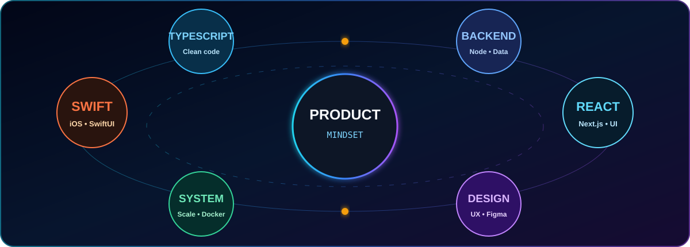
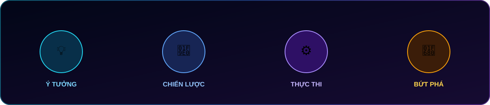

<div align="center">
  
</div>

<div align="center">

[](https://git.io/typing-svg)

[](https://github.com/buivanchuong9)
[](https://github.com/buivanchuong9?tab=followers)
[](https://github.com/buivanchuong9?tab=repositories)

</div>

<br />



## `01.` Chào bạn, mình là Chương 👨‍💻

Một developer mobile, yêu thích việc tạo ra những sản phẩm **đẹp ở giao diện, chắc ở hệ thống và tốt ở trải nghiệm**.

```swift
struct Developer {
    let name = "Bùi Văn Chương"
    let focus = ["iOS", "Web", "Sản phẩm số"]
    let mindset = "Học sâu · Làm kỹ"
}
```

- 🍎 Xây dựng trải nghiệm native với **Swift & SwiftUI**
- ⚛️ Phát triển giao diện hiện đại bằng **React & Next.js**
- 🧠 Quan tâm đến kiến trúc, hiệu năng và trải nghiệm người dùng
- 🚀 Luôn sẵn sàng biến một ý tưởng táo bạo thành sản phẩm chạy được
- ☕ Nhiên liệu: cà phê, âm nhạc và những bài toán thú vị

<br clear="both" />

---

## `02.` Bộ công nghệ của mình 🧰

<div align="center">

### Mobile & Apple Ecosystem


### Frontend


### Backend, dữ liệu & công cụ


</div>

---

## `03.` Bản đồ năng lực 🧭

<div align="center">
  
</div>

---

## `04.` Chế độ làm việc: luôn tiến về phía trước 🚀

<div align="center">
  
</div>

---

## `05.` Khám phá hành trình của mình trên GitHub 🛰️

<div align="center">
  <a href="https://github.com/buivanchuong9?tab=repositories">
    
  </a>
  <a href="https://github.com/buivanchuong9?tab=overview">
    
  </a>
</div>

---

## `06.` Tư duy làm sản phẩm ✨

<div align="center">

| 🧠 Tư duy | 🛠️ Thực thi | 🎨 Trải nghiệm | 📈 Phát triển |
|:---:|:---:|:---:|:---:|
| Hiểu đúng vấn đề | Code sạch, dễ bảo trì | Đơn giản và trực quan | Đo lường rồi cải tiến |
| Ưu tiên giá trị thật | Kiến trúc có chủ đích | Chăm chút từng chi tiết | Không ngừng học hỏi |

</div>

> “Code tốt không chỉ chạy đúng — nó còn phải dễ hiểu, dễ phát triển và tạo ra giá trị.”

---

## `07.` Kết nối và cùng xây dựng điều hay ho 🤝

<div align="center">

Nếu bạn có một ý tưởng thú vị, một dự án cần cộng tác hoặc chỉ đơn giản muốn trò chuyện về công nghệ — **hãy kết nối với mình!**

[](https://github.com/buivanchuong9)
[](https://github.com/buivanchuong9)

### Cảm ơn bạn đã ghé thăm🚀


</div>
